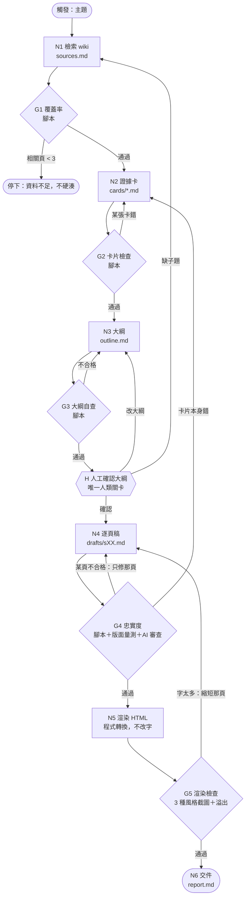

# Workflow 設計說明：從 LLM Wiki 到教學 HTML 簡報（graph 版）

> - 給 AI 照著跑的流程定義：[`workflows/topic-slides.md`](../workflows/topic-slides.md)
> - 一次實際執行的完整檢查紀錄：[`runs/ai-agents-intro/report.md`](../runs/ai-agents-intro/report.md)
> - 建 Wiki 前的訪談與特別考量：[`docs/interview.md`](interview.md)

## 1. 流程圖（目前版本 v2.1）

文字版：檢索 wiki → 覆蓋率關卡（不足就停）→ 證據卡 → 大綱 → 大綱自查 → **人工確認大綱** → 逐頁稿 → 忠實度檢查（只修不合格的頁）→ 程式渲染 HTML → 渲染檢查（3 種風格）→ 交件。

## 2. 為什麼用 graph，而不是「一個 prompt 寫完整份簡報」

- **出錯可以定位**：一個 prompt 寫完整份簡報時，錯了不知道錯在哪，修一頁往往整份重寫。拆成節點以後，每一關都知道是哪一頁、哪一張卡、甚至哪一個 wiki 頁出錯，只退回那一格。
- **每個節點只能看限定的東西**：證據卡只能讀**一個** wiki 頁，逐頁稿只能用大綱指定給這頁的卡。AI 能讀的範圍被收窄，就沒有空間把自己的知識混進來，檢查時也能逐句對回來源。
- **中間產物全部存檔**：`sources.md`、`cards/`、`outline.md`、`drafts/` 都是檔案，任何一個節點都能單獨重跑，不必從頭來。

## 3. 哪些步驟會重複

| 迴圈 | 範圍 | 上限 | 這次實際 |
|---|---|---|---|
| N2 ↔ G2 | 只重抽錯的那張卡 | 每張 2 輪 | G2 第 2 次通過（G4 審查發現卡片錯，回頭重抽 3 張） |
| N3 ↔ G3 ↔ H | 大綱自查不合格，或人工要求修改 | 2 輪 | G3 第 1 次通過，人工確認沒有修改 |
| N4 ↔ G4 | 只修被點名的頁 | 每頁 2 輪 | 腳本 11 次、AI 審查 4 輪（第 1 輪 7 頁不合格 → 第 2 輪全過；縮短後第 3 輪 1 頁不合格 → 第 4 輪通過） |
| N4 → N5 → G5 | 版面溢出時退回縮短 | 2 輪 | G5 第 6 次通過（第 1、2 次是溢出，第 4 次是截圖看出的呈現問題） |

## 4. 哪裡檢查、哪裡重新生成

| 關卡 | 誰檢查 | 檢查什麼 | 不合格時重新生成什麼 |
|---|---|---|---|
| G1 | 腳本 | 相關 wiki 頁 ≥ 3；6 篇論文都有涵蓋 | 少於 3 頁就**停下**，不用 AI 自己的知識硬湊 |
| G2 | 腳本 | 每張卡只來自一個 wiki 頁；出處標記與數字都在那頁找得到 | 只重抽錯的那張卡 |
| G3 | 腳本 | 10–15 頁、封面與小結、每頁有卡、6 篇論文都出場 | 重寫大綱 |
| H | 人 | 教學順序適不適合新手、有沒有缺子題 | 改大綱，或回 N1 補檢索 |
| G4 | 腳本＋Chrome 量測＋AI | 腳本：只用指定的卡、數字與出處都在卡上；量測：3 種風格都不溢出；AI：有沒有講反、誇大、新手看不看得懂 | 只重寫不合格的頁；錯在卡片 → 回 N2；錯在 wiki → 先修 wiki（lint 通過）再重抽卡 |
| G5 | Chrome headless | 正式檔 3 種風格 × 13 頁量測，另存 39 張截圖給人看 | 字太多 → 退回 N4 縮短那頁（不縮小字體硬塞） |

設計理由：

1. **能用程式檢查的都寫成腳本**（G1、G2、G3、G4 的一半、G5）。腳本每次結果一樣、不花 token、幾秒就跑完，也不會「覺得差不多就放行」。
2. **腳本做不到的才交給 AI 審查**，例如說法有沒有講反、有沒有誇大、新手看不看得懂。審查者每輪都是**新的 subagent，只拿到該頁稿、卡片和圖**，看不到寫稿時的對話，避免自己審自己。
3. **人只看一次，而且放在大綱**：方向錯了，在大綱階段改最便宜；逐頁稿以後的錯誤，腳本和 AI 審查都抓得到。
4. **渲染交給程式，不交給 AI**：`render_deck.py` 只做 Markdown → HTML 的格式轉換，所以 G4 通過的字就是最後呈現的字，渲染這一步不會再多出新的錯。
5. **退回只退到出錯的地方**：只修不合格的那頁，其他頁不動；如果追查下去是卡片或 wiki 的錯，就修源頭，不在稿子上打補丁。

## 5. 停止條件

- 全部關卡通過 → 交件（N6）。
- G1 相關頁少於 3 頁 → 一開始就停。
- 任一迴圈用完輪數上限仍不合格 → 停下，把剩下的問題寫進 `report.md` 交給人決定，不無限重試。

## 6. 實際執行一次：「AI Agents 是什麼？」（runs/ai-agents-intro）

| 關卡 | 結果 | 跑了幾次 | 重點 |
|---|---|---|---|
| G1 | ✅ | 1 | 選 13 個 wiki 頁，6/6 篇論文 |
| G2 | ✅ | 2 | 15 張卡；第 2 次是 G4 回溯修 wiki 後重抽 |
| G3 | ✅ | 1 | 13 頁 |
| H | ✅ | 1 | 使用者確認，未修改 |
| G4 腳本 | ✅ | 8＋3 | 自我測試：故意把 56.9 改成 59.6、多加一張卡，兩個錯都有抓到 |
| G4 AI 審查 | ✅ | 4 輪 | 第 1 輪 7 頁不合格（主詞被換掉、「影響」寫成「決定」、出處張冠李戴⋯），其中 3 個錯誤源頭在 wiki |
| G5 | ✅ | 6 | 第 1 次 4 頁溢出；第 2 次 S13 溢出；看截圖找到上標黏在一起 |

完整的逐次紀錄（含每輪 AI 審查原文）：[`report.md`](../runs/ai-agents-intro/report.md)、[`reviews/`](../runs/ai-agents-intro/reviews/)；截圖：[`screenshots/`](../runs/ai-agents-intro/screenshots/)。

## 7. 執行中對 workflow 的修改（v1 → v2 → v2.1）

| 版本 | 版面檢查在哪 | 為什麼改 |
|---|---|---|
| v1 | 只在最後的 G5 | — |
| v2 | G4 加上「版面高度估算」 | G5 第 1 次抓到 4 頁溢出，其中 2 頁是 G4 修忠實度時**加字**造成的。v1 要繞 N4 → N5 → G5 → N4 的大圈才會發現 |
| v2.1 | G4 直接渲染暫存檔，用 Chrome 實際量測（約 3 秒） | v2 的估算漏抓 S13（出處多，頁尾變高），補上之後又誤報 S10；誤差約 ±30px，調門檻也無法同時避免漏抓和誤報 |

v2.1 另外加了一條規則：**只刪掉不含事實的獨立區塊時，不必重做 AI 審查；只要改寫字句，就要重審。** 起因是 S13 為了縮短把兩句接成一句，變成「所有 agent 都由四塊積木組成」的過度概括，AI 審查第 3 輪把它打回。

## 8. 反思

### 我的回答

**Q1. 哪個節點最常出錯？**

我覺得是在文章內容的部份，可能是因為AI會自己加東西進去，需要檢查這個地方才會修改。

**Q2. 發現問題後把檢查往前移到哪一步？**

往前移到G4，移了之後速度有變快。

**Q3. 有沒有因此改 workflow／graph，為什麼？**

我沒有改。

### 對照的檢查紀錄（AI 整理，供參考）

- **文章內容（N4 逐頁稿）**：AI 審查第 1 輪 13 頁中有 7 頁不合格，問題都是「多加了卡片沒有的東西」或「把話說得比原文更滿」。例如：把 ReAct 作者批評 CoT 的話套到所有 LLM；把「影響」寫成「決定」；圖裡加了卡片沒有的例子。
- **錯誤有時源自上游**：其中 3 個錯誤追查下去是 wiki 本身就寫錯（章節標錯、寫了原文沒說的推論）。lint 腳本只能比對數字和格式，抓不到這類錯誤。
- **檢查往前移到 G4**：版面溢出原本要到 G5 才發現。移到 G4 以後，修內容和修長度在同一個小迴圈裡完成，G4 實際量測一次約 3 秒。
