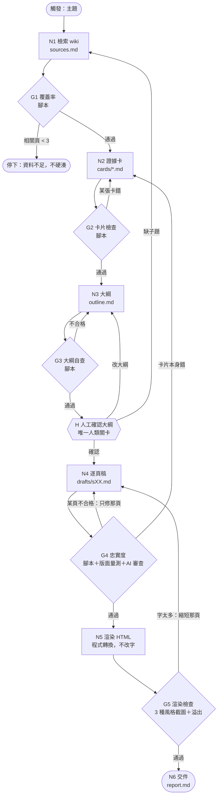

# Workflow：從 wiki 產生教學 HTML 簡報（graph 版）

> 觸發：「用 topic-slides 流程做『＿＿』的簡報」。只能用 wiki 的內容。
> 每次執行建立一個資料夾 `runs/<topic>/`，所有中間產物都存檔、可以單獨重跑。
> 設計理由與討論見 `docs/workflow-design.md`。

## 流程圖



## 每個節點：只能看什麼、產出什麼、不能做什麼

| 節點 | 只能看 | 產出 | 不能做 |
|---|---|---|---|
| N1 檢索 | `wiki/index.md` → 挑出的 wiki 頁 | `sources.md`（頁面清單＋為什麼選） | 讀 `raw/` 原文 |
| N2 證據卡 | **一個** wiki 頁 | `cards/cNN.md`（每張卡只來自一頁；句子保留 wiki 的出處標記） | 混入其他頁或自己的知識；引用 `> 💭` 筆記 |
| N3 大綱 | 卡片 | `outline.md`（每頁：標題、教學角色、用哪幾張卡、這頁要讓讀者懂什麼） | 引用沒有卡的內容 |
| H 人工確認 | 大綱 | 使用者回覆（確認／改大綱／補檢索） | — |
| N4 逐頁稿 | 大綱＋該頁的卡 | `drafts/sNN.md` | 引用該頁卡片以外的內容 |
| N5 渲染 | 通過 G4 的逐頁稿 | `slides/index.html`（`scripts/render_deck.py`） | 改任何一個字（由程式保證） |
| 檢查關卡 | 成品＋來源 | `report.md` 的一節 | 自己動手改 |

## 檢查關卡

| 關卡 | 方式 | 檢查內容 | 不合格退回 |
|---|---|---|---|
| G1 覆蓋率 | `scripts/g1_coverage.py` | 清單裡的頁都存在；相關頁 ≥ 3；6 篇論文都至少有一頁涵蓋 | 少於 3 頁 → **停下**；缺論文 → N1 補 |
| G2 卡片 | `scripts/g2_cards.py` | 每張卡只連一個 wiki 頁；每句有 `[@出處]`；出處和數字都能在該 wiki 頁找到；不引用 💭 筆記 | 只重抽錯的那張卡 |
| G3 大綱 | `scripts/g3_outline.py` | 10–15 頁；第一頁是封面、最後一頁是小結；內容頁都有卡；卡片存在；6 篇論文都有出場 | N3 |
| H 人工 | 使用者 | 教學順序是否適合新手、有沒有缺子題 | N3 或 N1 |
| G4 忠實度 | `scripts/g4_drafts.py`＋**AI 審查（新的 subagent，只給該頁稿與卡片）** | 腳本：只用大綱指定的卡、數字與出處都在卡上、有數字的段落都有出處、**版面實際量測：渲染成暫存檔、3 種風格都不溢出（v2.1）**。AI：說法有沒有講反、有沒有誇大、新手看不看得懂 | 只修不合格那頁；卡片錯 → N2 |
| G5 渲染 | `scripts/g5_render.py`（Chrome headless） | 3 種風格 × 每頁：文字不溢出、圖有載入；存截圖 | 字太多 → N4 縮短那頁（不是縮小字體硬塞） |

## 版本紀錄

- **v1**（第一次執行）：字數／版面只在最後的 G5 檢查。
- **v2**（第一次執行後修改）：G5 第 1 次抓到 4 頁溢出，其中 2 頁是 G4 修內容時加字造成的，要繞「N4 → N5 → G5 → N4」大圈才發現。
  → 把檢查往前移：`scripts/layout_estimate.py` 依 CSS 估算每頁高度，放進 G4 腳本；用 G5 實測值校準（估算偏保守，G5 仍是最終把關）。
  好處：修內容（G4 迴圈）和修長度在同一個小圈完成，不用每次都渲染＋開瀏覽器截圖。

- **v2.1**：v2 的估算在 G5 第 2 次漏抓 S13（出處多 → 頁尾變高），修正後又誤報 S10；估算誤差約 ±30px。
  → 改成 G4 直接渲染暫存檔、用 Chrome 實際量測（`scripts/measure.py`，約 3 秒），估算停用。G5 留作最終量測＋截圖。
  → 新規則：只刪除獨立且不含事實的區塊時不用重做 AI 審查；改寫字句就要重審（縮短時曾把兩句接成一句，變成過度概括）。

## 會重複的地方（每一格裡面還是 loop）

- **N2 ↔ G2**：每張卡寫 → 檢查 → 修，最多 2 輪。
- **N4 ↔ G4**：每頁寫 → 腳本檢查 → AI 審查 → 只修被點名的頁，每頁最多 2 輪。
- **N4 → N5 → G5**：版面溢出時退回 N4 縮短，最多 2 輪。

## 停止條件

- 全部關卡通過 → 交件。
- G1 相關頁少於 3 頁 → 一開始就停，不用自己的知識硬湊。
- 整份最多 3 輪（任一節點的修改輪數用完仍不合格 → 停下，把剩下的問題寫進 report.md 交給人決定）。

## 檔案

```
runs/<topic>/
├── sources.md       N1
├── cards/           N2
├── outline.md       N3
├── drafts/          N4
├── reviews/         G4 的 AI 審查紀錄
├── screenshots/     G5
└── report.md        每一關的檢查結果（腳本自動附加）
slides/index.html    N5 產出（GitHub Pages）
```
